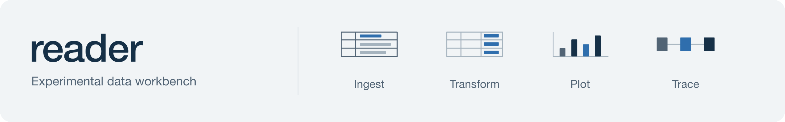

# 

[](https://github.com/e-south/reader/actions/workflows/checks.yaml?query=branch%3Amain)
[](https://app.codecov.io/gh/e-south/reader/tree/main)
[](https://pypi.org/project/reader-workbench/)
[](https://docs.python.org/3.12/)
[](https://github.com/e-south/reader/blob/main/LICENSE)

Reader turns plate-reader workbooks and flow-cytometry files into tables you
can plot, export, or open in a notebook. Each experiment keeps its raw files
and sample metadata in `inputs/`. Its `config.yaml` selects a protocol and
declares how to process the measurements. Reader writes results to `outputs/`
and records which inputs and settings produced them.

## Try the CLI

Install the `reader-workbench` package with [uv](https://docs.astral.sh/uv/).
The CLI is `reader` and the Python module is `reader_workbench`.

```bash
uv tool install reader-workbench --python 3.12
reader demo
reader protocols
```

`demo` prints a command tour. To try a protocol, run these commands in an
empty working directory. They create a single-reporter experiment and check
its configuration before you supply measurements.

```bash
reader init ./experiments/first_plate --protocol plate_reader/single_reporter_screen
reader validate ./experiments/first_plate/config.yaml --no-files
```

To produce your first records, follow [Run a sample plate](https://github.com/e-south/reader/blob/main/docs/guides/demo.md).
The example supplies two small workbooks, runs the pipeline, and verifies
the saved measurements against the inputs.

## Use Reader with your data

- [Getting started](https://github.com/e-south/reader/blob/main/docs/guides/getting_started.md) explains what goes in the experiment directory and what each preflight check covers.
- [Common tasks](https://github.com/e-south/reader/blob/main/docs/guides/common_routes.md) covers finding experiments, running a pipeline, generating outputs, and scripting the CLI.
- [Python API](https://github.com/e-south/reader/blob/main/docs/core/python_api.md) shows how to open an experiment and read a verified dataframe by record ID.
- [Documentation index](https://github.com/e-south/reader/blob/main/docs/README.md) links to protocol guides, provenance, and maintainer references.

## Develop from a checkout

```bash
git clone https://github.com/e-south/reader.git
cd reader
uv sync --locked --group dev
uv run reader demo
```

Use `uv run reader` in the checkout to test local changes. See the
[repository change gate](https://github.com/e-south/reader/blob/main/docs/repo-change-gate.md)
for the checks to run before submitting a change.
